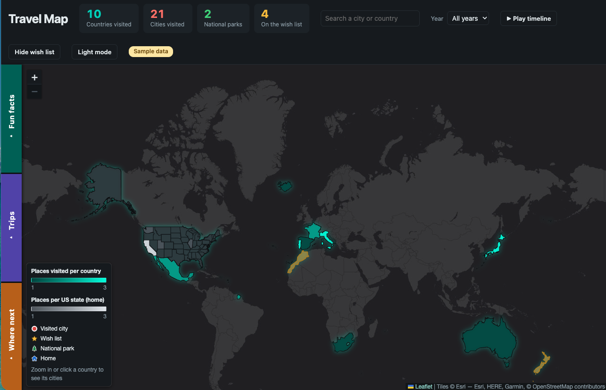

# Travel Map

An interactive map of everywhere I've been, built with [Leaflet](https://leafletjs.com/) and plain HTML, CSS and JavaScript. Places live in a single CSV file; a small Python server lets the page add, edit and delete them.

**Live demo: <https://julesf90.github.io/travel-map-public/>**

[](https://julesf90.github.io/travel-map-public/)

The demo is view-only and shows made-up sample places (`places.sample.csv`), not my real travel history.

## Features

- **Shaded countries and US states** on a light-to-dark scale by number of places visited, with a legend
- **Pins by kind**: dots for cities, trees for national parks, stars for the wish list, a house for home; nearby pins cluster into numbered bubbles
- **Counters** for countries, cities, national parks and wish-list places; click one to list what it counts
- **Year filter and timeline playback** that steps through the years and adds places as it goes
- **Trips**: places grouped into named trips, drawn as curved lines, with search, rename and combine
- **Fun facts**: share of the world explored, continents, busiest year, farthest-apart cities and more
- **Where next**: suggestions based on where you've been, or on descriptors you type ("beach, food, hiking")
- **Add, edit and delete** places from the page, with type-ahead country and state lists
- **Search**, **dark mode**, **save the view as an image**, and **export a read-only single-file copy**

## Run it locally

Requires Python 3 (no packages to install).

```bash
python3 server.py
```

Then open <http://localhost:8765>.

The first run copies `places.sample.csv` to `places.csv`, which is the file the map reads and edits. `places.csv` is listed in `.gitignore`, so your own places stay on your computer.

## The data file

`places.csv` has one row per place:

| Column | Meaning |
| --- | --- |
| `type` | `city`, `country`, `National Park` or `home` |
| `name` | Place name |
| `state` | State or region (optional) |
| `country` | Country |
| `lat`, `lon` | Coordinates; leave blank to have them looked up by name |
| `date_visited` | A year, a day (`2023-04-01`) or a range (`2023-04-01 to 2023-04-05`) |
| `notes` | Shown in the popup |
| `status` | `wishlist` for places you want to visit; blank for visited |
| `trip` | Trip name; places without one are grouped by country and year |
| `photo`, `link` | Web addresses shown in the popup |

## How it works

- `index.html` is the whole front end. It loads Leaflet and the marker-cluster plugin from a CDN, country borders from Natural Earth, and base-map tiles from Esri.
- `server.py` serves the folder and exposes a few JSON endpoints that rewrite `places.csv`. It listens on localhost only and keeps a backup before each edit.
- When the page is not running on localhost (for example on GitHub Pages) it is view-only: the editing controls are hidden and it falls back to the sample data.

## Credits

Map tiles © Esri. Borders from Natural Earth. Place lookups by OpenStreetMap Nominatim.
